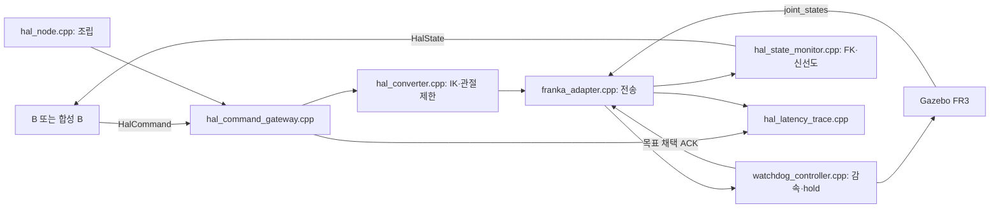

> 2026-10-07 업데이트: FR3 전용 변환/전송은 공통 HAL로 확장되었습니다. 현재 구조와 UR5e 실행은 [공통 HAL 보고서](scenario4-common-hal-2026-10-07.md)를 참고하세요. 아래는 이전 FR3 구현 설명입니다.

# FR3 C HAL — 파일별 구현과 설계 이유

2026-10-06. 이번 범위는 **FR3 Gazebo**, B/C v0.3 계약이다.
UR5e용 C++ 파일과 `robot_ur5e.yaml` 추가는 보류한다. 기존 UR Python 경로는 유지한다.
실제 패키지 이름은 팀 저장소와 빌드를 따라 `pac_hal`이다.
요청 표의 `hal_system` 역할은 `pac_hal/launch/hal_system.launch.py`가 담당한다.

## 1. 진행표와 실제 위치

| 번호 | 요청 파일 | 실제 위치 / 진행 | 책임 |
|---|---|---|---|
| 1 | hal_system.launch.py | src/pac_hal/launch/hal_system.launch.py, 구현 | 설정 검증, snapshot, controller 준비, C++ 실행 |
| 2 | robot_fr3.yaml | src/pac_hal/config/robot_fr3.yaml, 구현 | 좌표·관절·제약·통신·시간·로그 계약 |
| 3 | robot_ur5e.yaml | 추가 보류 | FR3 검증 후 새 어댑터/모델 추가 |
| 4 | hal_node.cpp | src/pac_hal/src/hal_node.cpp, 구현 | 노드 조립, subscriber/timer, 단일 executor |
| 5 | hal_command_gateway.cpp | src/pac_hal/src/hal_command_gateway.cpp, 구현 | 명령 수명과 검증·실행 순서 |
| 6 | hal_converter.cpp | src/pac_hal/src/hal_converter.cpp, 구현 | 공식 URDF KDL chain, map↔base↔TCP, IK/FK/Jacobian |
| 7 | robot_adapter.hpp | src/pac_hal/include/pac_hal/robot_adapter.hpp, 구현 | 제조사/전송 공통 경계 |
| 8 | franka_adapter.cpp | src/pac_hal/src/franka_adapter.cpp, 구현 | Gazebo Franka 내부 관절 명령·측정·ACK |
| 9 | hal_state_monitor.cpp | src/pac_hal/src/hal_state_monitor.cpp, 구현 | 측정 신선도, READY/ACTIVE/FAULT, TCP 상태 |
| 10 | hal_latency_trace.cpp | src/pac_hal/src/hal_latency_trace.cpp, 구현 | 단계별 monotonic CSV와 명령/ACK 연결 |
| 시험 | fake_ai_node.py | src/pac_hal/pac_hal/fake_ai_node.py, 구현 | A→B 정상·장애 입력 생성 |

`include/pac_hal/*.hpp`는 C++ 클래스의 공개 규격, `src/*.cpp`는 구현이다.
`hal_types.hpp`에는 공유 자료형/설정/측정/결과를 모아 서로의 내부 코드를 참조하지 않게 했다.
`fake_ai_node.py` ROS 실행 진입점은 `scripts/fake_ai_node.py`이고 실제 노드는 위 Python 모듈이다.

## 2. 전체 호출 관계



상위 B는 `/hal/final_command`, `/hal/state`, `/hal/error` 공통 계약으로 C와 만난다.
C 내부 관절 토픽을 B에서 직접 쓰면 IK/제한/TTL 검사를 우회하므로 어댑터 내부에 가둔다.

## 3. hal_system.launch.py — 실행 순서를 정하는 파일

입력은 `robot`, `config_file`, `session_id`, `run_id`, `log_directory`, `backend`다.
FR3 기본 설정 파일은 `robot_fr3.yaml`, Gazebo 기본 실행 파일은 C++ `hal_node`다.

시작 순서는 다음과 같다.

1. profile YAML을 읽는다.
2. CLI의 session/run/log 값을 반영하고 기존 Python `validate_config`로 전체 v0.3 스키마를 검사한다.
3. 검사된 설정을 임시 snapshot YAML로 저장한다.
4. `prepare_hal_controller`로 Gazebo URDF를 확인하고 관절 제어기를 C의 position controller로 전환한다.
5. 준비가 성공한 경우에만 C++ `hal_node`를 시작한다. 준비 실패는 launch를 종료한다.

**왜 snapshot인가:** 실행 중 YAML을 수정해도 C와 수신단이 서로 다른 제한/세션을 쓰면 안 된다.
변경은 새 세션에서 재시작하여 반영한다. C++ 실행 파일도 핵심 설정을 다시 검증한다.

이 파일은 기존 Gazebo의 C만 켠다. 작업대와 Gazebo까지 한꺼번에 켜는 파일은
`hal_simulation.launch.py`다. 따라서 C launch만 켜고 Gazebo 창이 생기기를 기다리면 안 된다.

## 4. robot_fr3.yaml — 하위 장치 차이를 명시하는 파일

| 그룹 | C가 사용하는 의미 | 설정 이유 |
|---|---|---|
| robot | FR3, franka_fr3 어댑터, gazebo backend | 다른 모델/실물 연결을 암묵적으로 선택하지 않음 |
| frames | map/base/flange/TCP와 설치·도구 변환 | B가 제조사 링크 이름과 장착 위치를 몰라도 map TCP를 사용 |
| joints | URDF 순서, 장치 index, 부호, 영점, 위치/속도/가속도 제한 | 관절 번호와 단위 차이를 명시적으로 흡수 |
| workspace | TCP 좌표 직육면체 | 명백한 범위 오류를 IK 전에 저렴하게 거부 |
| timing | 1ms 명령 예정, 5ms TTL, 측정 stale/lost, IK 예산 | ROS 시간과 wall-clock 제어 시간 혼동 방지 |
| ik | KDL, 최대 반복, 잔차, seed | 시간 제한과 해의 연속성 관리 |
| transport | controller 이름, 관절 명령·측정·ACK 토픽 | 제조사별 연결을 B 공통 토픽과 분리 |
| topics/qos | 공통 B/C 채널 | 오래된 명령 큐 적체를 피하고 오류 전환 이벤트는 신뢰 전송 |
| runtime | 활성 session, heartbeat 주기 | 다른 RUN에서 남은 명령 배제 |
| logging | run_id, 저장 위치, 활성화 | 다른 로봇/실험 로그 혼합 방지 |

좌표 식은 다음과 같다.

```text
map_T_tcp = map_T_base × base_T_flange(q) × flange_T_tcp
IK 목표 base_T_flange = inverse(map_T_base) × map_T_tcp × inverse(flange_T_tcp)
q_device[device_index] = direction × q_urdf + zero_offset_rad
```

기본 설치/TCP 변환은 항등 변환으로, 원점 설치·도구 없음 시뮬에 맞춘 값이다.
실제 도구를 붙이면 `flange_to_tcp`, 로봇 베이스를 옮기면 `reference_to_base`를 확정해야 한다.
실제 Gazebo 배치도 같이 맞춰야 한다. C의 좌표 설정만 바꾸면 Gazebo 모델이 이동하는 것은 아니다.

`0.5rad/s`, `1rad/s²`는 느린 시뮬 시험 제약이다. 제조사 최대 성능이라고 해석하지 않는다.
관절 위치 제한은 공식 URDF와 YAML의 교집합을 적용한다.
`max_tcp_speed/acceleration`은 B 경로 생성 합의값이며 C의 현재 실행 제한은 관절 공간에서 검사한다.
workspace는 충돌 회피/도달 가능 영역이 아니다. 범위 안의 목표도 IK가 실패할 수 있다.
기존 `franka_fr3.yaml`은 과거 Python profile 호환 파일이며 새 FR3 C++ 기본은 `robot_fr3.yaml`이다.

## 5. hal_node.cpp — 조립과 수명 관리

`HalNode`가 YAML을 읽고 `HalCommandGateway`를 만든다.
`/hal/final_command` subscriber는 메시지를 gateway에 전달하고, wall timer는 heartbeat를 호출한다.

**왜 node를 작게 두는가:** main에 IK/전송/상태/로그를 섞으면 실행 설정과 알고리즘을 따로 시험하기 어렵다.
converter와 monitor는 node 없이 C++ 단위 테스트로 검사할 수 있도록 분리했다.

단일 executor를 사용한다. 명령·관절 측정·ACK 콜백을 직렬 처리하므로 공유 상태를 동시에 수정하지 않는다.
이 선택은 B의 1kHz RT 스레드와 다르다. C에서 파일 I/O와 ROS 처리를 한다고 B RT 안에 넣는 것은 아니다.
무통신 정지는 독립 C++ controller가 담당하므로 gateway가 멈춰도 계속 검사한다.

## 6. hal_command_gateway.cpp — 명령 검증과 실행 책임

### validate: 저렴한 검사부터

1. session이 같은 양수인가: 다른 RUN에서 온 명령은 E_FORMAT.
2. command_seq가 증가하는가: 중복/역순은 E_FORMAT.
3. mode=POSITION, frame=map인가: 다른 의미를 추측해서 실행하지 않고 E_UNSUPPORTED.
4. created가 같은 PC CLOCK_MONOTONIC의 과거/현재인가, expires=created+5ms인가: 형식 오류는 E_FORMAT.
5. 이미 expires를 넘었는가: E_EXPIRED.
6. 위치와 quaternion이 유한하고 quaternion이 정규화되었는가: NaN 등 E_FORMAT.
7. workspace 안인가: E_OUT_OF_RANGE.

검증 순번은 형식 검사를 통과하면 소비한다. IK 실패한 명령을 다시 보내도 최신 명령이 되지 않는다.
운동 전에 converter 초기화와 신선한 실제 측정, 활성 수신단을 확인한다.

### command: 계산과 전송

검증 통과 → measured/last solution seed → converter IK → 관절 위치/속도/가속도 검사
→ 신선도 재검사 → adapter에서 TTL 재검사 → 전송한다.

관절 속도/가속도는 목표 생성 간격 dt로 계산한다.

```text
velocity = (q_new - q_last_sent) / dt
acceleration = (velocity - velocity_last_sent) / dt
```

**왜 전송 성공 이후에만 last 값을 갱신하는가:** 거부한 목표를 이미 실행한 것처럼 다음 명령의 기준으로 쓰면 안 된다.
처음에는 실제 측정 관절을 사용한다. 목표가 갑자기 점프하면 자르거나 몰래 보간하지 않고 거부하여 B가 경로를 늦추게 한다.
수신단에서도 별도로 속도/가속도 제한을 적용한다.

결과는 전송된 경우 CMD_SENT, 그 밖에는 CMD_REJECTED다.
HalError는 상태가 발생/해제될 때만 발행한다. 1ms마다 같은 오류 이벤트를 쌓지 않는다.
source_result_id는 A 결과 연결용 필드이며 C의 TTL/순번 검사 대신 사용할 수 없다.

## 7. hal_converter.cpp — 모델 기반 변환

`load_fr3_config`는 launch를 우회한 직접 실행도 잘못된 FR3/session/시간/QoS/관절 제한을 거부한다.
전체 스키마 검사와 snapshot 작성은 launch의 기존 Python 계약 검증기가 담당한다.

`initialize`는 Gazebo URDF를 확인하고 공식 FR3 base→flange KDL chain을 구성한다.
joint 수는 7개, 이름/순서는 설정과 같아야 한다. 모델의 위치/속도 한도를 설정으로 넓힐 수 없다.

`inverse`는 map TCP 목표에서 설치·도구 변환을 제거하여 flange 목표를 만든다.
직전 해를 seed로 사용하는 것은 FR3 7축의 여러 가능한 해 중 갑작스러운 자세 전환을 줄이려는 선택이다.
NR_JL solver로 관절 제한 안에서 IK를 풀고, 계산 예산과 FK 잔차를 확인한다.
실패/시간 초과는 E_IK_FAILED, 관절 범위 초과는 E_OUT_OF_RANGE다.

500us 검사는 **계산 완료 후 결과를 버리는 검사**다. 실행을 500us에 강제 선점하거나 OS 지연을 보장하지 않는다.
진짜 hard RT 성능은 별도 측정과 구현이 필요하다.

`forward`는 실제 joint_states로 map TCP pose를 구한다.
속도가 유효하면 Jacobian으로 flange twist를 구하고 `ω × tool_offset`을 더하여 TCP twist를 만든다.
도구 offset이 있는데 flange 속도를 그대로 TCP 속도로 사용하면 틀리므로 이 항을 포함했다.

## 8. robot_adapter.hpp — 로봇별 공통 규격

`RobotAdapter::send(command, canonical_joints)`와 `AdapterCallbacks`만 공개한다.
콜백은 모델 설명, 실제 관절 측정, 수신단 ACK 세 종류다.

**왜 공통 규격을 두는가:** 새 로봇의 SDK/토픽/장치 번호를 gateway에 추가하면 B/C 공통 명령 코드가 로봇별 분기로 커진다.
상위 흐름은 유지하고 어댑터 구현만 바꿀 경계를 만든다.
이번 factory는 Franka Gazebo만 생성한다. UR C++ factory는 아직 만들지 않았다.

`send` 성공은 DDS 전송 호출이 성공했다는 뜻이다. 실제 관절 적용은 Receiver ACK로,
TCP 이동은 측정 FK로 확인한다. 모두 같은 성공 상태로 섞지 않는다.

## 9. franka_adapter.cpp — Gazebo FR3 통신

FrankaGazeboAdapter가 C 내부 관절 publisher와 robot_description/joint_states/status subscriber를 소유한다.
URDF는 transient_local로 받아 시작 전에 발행된 모델도 읽는다.

joint_states 배열 순서가 바뀌어도 이름으로 7축을 찾아 canonical 순서로 다시 정렬한다.
관절 누락/비유한 위치는 새 측정으로 받지 않는다. 속도가 누락되면 pose만 유효하고 twist는 무효다.
joint_states는 URDF 기준 rad이므로 장치 부호/offset을 두 번 적용하지 않는다.

전송할 때만 `device_index/direction/offset`을 적용한다.
IK 중 만료될 수 있으므로 전송 직전 5ms TTL을 다시 확인한다.
수신단 subscriber가 없으면 E_SEND_FAILED로 실패 처리한다.

실물 `franka::Robot`에 연결하는 libfranka 어댑터가 아니다. 현재 이 파일은 Gazebo 내부 관절 프로토콜을 구현한다.
FR3 모델명만 바꿔 실물로 연결할 수 있게 만들지 않았다.

## 10. hal_state_monitor.cpp — 상태와 신선도

관절 측정의 Gazebo stamp가 증가하고 FK 계산이 성공할 때만 다음을 갱신한다:

- 마지막 measured q/dq, pose/twist
- state_seq
- received_mono_ns
- 실제 측정 header.stamp

새 receiver 상태도 session/축 수/monotonic 순서를 확인하고 오래된 상태를 버린다.
측정과 receiver 활성 상태가 모두 신선할 때만 READY/ACTIVE가 된다.
receiver 목표 속도가 0이면 READY, 움직이는 명령이면 ACTIVE다. 실제 TCP 도달 판정은 따로 해야 한다.

측정 stale이면 pose_valid=false, twist_valid=false다.
pose는 마지막 측정값을 담아도 valid=false이므로 B가 이를 새 측정으로 사용하면 안 된다.
Gazebo pause/동일 stamp/역순은 freshness를 갱신하지 않는다. sim reset은 새 HAL 세션으로 재시작한다.

heartbeat는 상태 발행만 반복하고 측정 시각/순번을 바꾸지 않는다.
현재 profile은 예상 측정 10ms → stale 30ms, lost 100ms다. 대상 PC의 실제 주기로 합의/조정한다.

## 11. hal_latency_trace.cpp — 지연 기록

| 칸 | 의미 |
|---|---|
| t1 | C 명령 콜백 수신 CLOCK_MONOTONIC |
| t2 | session/형식/TTL/workspace 검사 종료 |
| t3 | IK와 관절 검사 단계 종료, 실패 시도도 종료 시각 기록 |
| t4 | 전송 단계 진입, 이후 adapter에서 만료 재검사 |
| t5 | 공통 계약에 상관된 측정 ACK가 없어 빈 칸 |
| t6 | C 내부 수신단 목표 채택 ACK를 gateway가 받은 시각 |

sent/rejected 행을 쓰고, ACK가 오면 같은 session/seq로 applied 행을 별도로 쓴다.
수신단 상태는 100Hz라 모든 1ms 명령 ACK를 기록하지 않는다.
최근 256개 명령만 연결용으로 보관해 메모리가 무한 증가하지 않게 했다.

파일은 `log_directory/run_id/hal.csv`, 기존 파일이 있으면 시작을 실패시킨다.
실험을 다시 할 때 새 run_id를 사용한다. 같은 파일을 이어써 서로 다른 실험이 섞이지 않게 하는 선택이다.
파일 I/O는 비RT C executor에만 있고 controller update/B RT thread에는 없다.

## 12. 수신단 watchdog_controller.cpp — 추가로 필요한 파일

요청 표 밖이지만 정지 기능에 꼭 필요하여 기존 C++ controller를 유지했다.
이 파일을 gateway 속에 합치면 gateway가 죽거나 메시지가 끊길 때 정지를 실행할 주체가 사라진다.

수신단에서 session/축 수/유한값/관절 범위/5ms 만료를 다시 확인한다.
ROS callback은 RealtimeBuffer에 최신 목표를 넘기고 controller update는 속도/가속도 제한으로 position을 출력한다.
목표 만료 또는 무통신이면 감속하여 hold한다. 이는 실물 비상정지/충돌 감지 기능을 대신하지 않는다.

## 13. fake_ai_node.py — A→B 장애 시험

이 노드는 **ControlCommand → /ai/control_command**를 발행한다.
C가 받는 HalCommand와 다르므로 이 노드만 켜면 로봇이 움직이지 않는다.
B 미완성 동안 C 통합 시험은 기존 `hal_demo_publisher`가 맡는다.

| mode | 생성 내용 | 나중에 B에서 확인할 처리 |
|---|---|---|
| normal | map position [x,y,z,0], confidence=.95, 짧은 age | 유효 목표 반영 |
| not_detected | ST_NOT_DETECTED, confidence=0 | 검출 실패 경로 |
| low_confidence | confidence=.1 | confidence_min 미만 폐기 |
| stale | age_ns=250ms | AI TTL 200ms 초과 폐기 |
| invalid_number | target[0]=NaN | 비유한 값 폐기 |
| drop | drop_after_s 뒤 발행 중단, 노드는 생존 | 메시지 수신 timeout 처리 |

부팅마다 새로운 writer_boot_id, 증가 seq를 사용한다.
문서 버전 v0.3과 메시지 layout_version은 다르다. 제공 문서의 layout_version 현재 값은 **1**이다.
age_ns는 가짜 카메라 수신부터 발행까지 A 내부 경과시간이며 다른 PC의 절대 monotonic 시간을 보내지 않는다.
목표 숫자는 개발용 synthetic 값이다. 실제 검출·카메라 캘리브레이션 결과가 아니다.

```bash
ros2 run pac_hal fake_ai_node.py --ros-args -p mode:=normal
ros2 run pac_hal fake_ai_node.py --ros-args -p mode:=stale
ros2 run pac_hal fake_ai_node.py --ros-args -p mode:=invalid_number
ros2 run pac_hal fake_ai_node.py --ros-args -p mode:=drop -p drop_after_s:=2.0
```

mode/rate는 실행 시 고정이다. 모드별 프로세스를 동시에 발행하지 말고 이전 것을 Ctrl+C로 끄고 바꾼다.
`nan`은 ROS YAML에서 숫자로 해석될 수 있어 mode 이름은 `invalid_number`를 사용한다.

## 14. 지금 실행하는 방법

워크스페이스는 `/home/jaewon/Documents/ChatGPT/intellion/ros2_ws`다.
소스는 `vendor/PAC2026-HyundAI-ntellion/PAC2026/src/pac_hal`에 있고 workspace/src는 이 소스로 연결된다.

빌드:

```bash
cd /home/jaewon/Documents/ChatGPT/intellion/ros2_ws
source /opt/ros/jazzy/setup.bash
source install/setup.bash
colcon build --symlink-install --packages-select pac_hal
source install/setup.bash
```

작업대+Franka+C++ HAL, 터미널 1:

```bash
cd /home/jaewon/Documents/ChatGPT/intellion
bash scripts/launch_hal_sim.sh session_id:=42
```

B 미완성일 때 움직임 시험, 터미널 2:

```bash
cd /home/jaewon/Documents/ChatGPT/intellion
bash scripts/run_hal_demo.sh --session-id 42 --output logs/fr3-cpp-motion.json
```

6초 2mm 왕복 후 송신을 중단하고 실측 TCP 이동과 watchdog 정지를 확인한다.
현재 이미 시뮬레이터가 켜져 있으면 첫 명령은 다시 실행하지 말고 두 번째만 실행한다.
기존 B publisher가 있으면 대체 노드는 시작을 거부한다.

기존 Gazebo에서 C만 켜는 직접 ROS launch:

```bash
export ROS_DOMAIN_ID=42
ros2 launch pac_hal hal_system.launch.py robot:=franka_fr3 session_id:=42 \
  run_id:=fr3_cpp_test_001 log_directory:=/tmp/pac_logs
```

오류 명령 시험은 demo가 종료된 뒤:

```bash
ros2 run pac_hal hal_fault_probe --session-id 42 --output /tmp/fr3-faults.json
```

미래 B는 같은 PC CLOCK_MONOTONIC, 같은 session, 증가 command_seq, map TCP Pose,
created+5ms expires, 계약 QoS로 `/hal/final_command`에 발행하면 된다.
실제 B가 준비되면 synthetic B를 끄고 연결하며 C++ 파일을 다시 수정할 필요는 없다.


## 15. 이번 실행의 검증 결과

- C++ `hal_node` Gazebo 실행과 측정 TCP 약 1.999919mm 이동 확인.
- 입력 중단 후 수신단 watchdog 활성과 속도 0 확인.
- 만료·중복·workspace 밖·도달 불가 명령 거부 검사 통과.
- 기존 Python 36개 + FR3 C++ 7개 = 43 tests, errors/failures/skipped 모두 0.
- Python flake8와 새 C++ 헤더/소스 cpplint 통과.
- fake AI 6개 정상/장애 모드 메시지 실제 ROS 송수신 검사 통과. B의 처리 결과는 아직 B 미완성으로 검사하지 않았다.
- C++ CSV에 수신/검증/IK/전송/목표 채택 ACK 행과 시각 순서 확인. t5는 빈 칸 유지.

IK 예산 초과로 일부 명령이 거부되는 이벤트도 관찰됐다. 이 시뮬레이션이 1kHz±100us나
실물 Franka 성능을 입증하는 것은 아니다. TCP 도달/충돌 회피/용접 완료 판정은 별도 기능이다.
변경은 새 세션에서 재시작하여 반영한다. C++ 실행 파일도 핵심 설정을 다시 검증한다.
