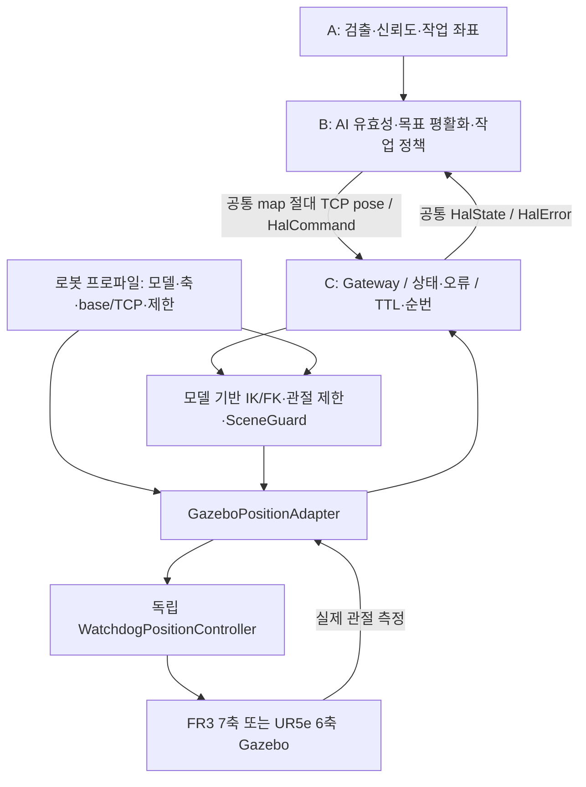

# 시나리오 4: FR3·UR5e 공통 C++ HAL

작성일 2026-10-07. 로컬 구현·Gazebo 검증 보고서. 추가 push·PR·병합은 하지 않았다.
대회 기준은 `competition-baseline.md`를 따른다. 범위는 FR3와 UR5e 교체 실행이며, 현대 로봇 협업·실물 용접을 구현한 결과가 아니다.

## 계층 경계와 변경



- A/B 소스와 `intelion_interfaces` 메시지 정의는 수정하지 않았다. A 판단·가중치·작업 목표 평활화·복구 정책을 C에 옮기지 않았다.
- `hal_node`: 두 로봇 모두 같은 C++ gateway 실행. UR만 기존 Python gateway를 쓰던 런치 분기를 제거했다. 기존 Python 실행 파일은 이전 실험용으로 남지만 기본 경로는 아니다.
- `robot_config.cpp`: FR3/UR5e Gazebo 프로파일 로딩과 검증을 IK와 분리했다. 실제 관절 순서는 URDF chain과 대조한다. 실물 backend는 거부한다.
- `hal_types.hpp`: 최대 7축 저장 공간 + `joint_count`. 활성 6/7축만 IK·제한·상태·전송에 사용하고 UR의 비활성 7번째 값은 로봇 관절로 해석하지 않는다.
- `hal_converter.cpp`: 같은 좌표 변환/FK/IK 잔차 검사를 사용한다. 초기화 때 6×6 또는 6×7 고정 SVD를 선택한다. 실행 중 로봇 모델을 바꾸지 않는다.
- `gazebo_adapter.cpp`: 기존 `franka_adapter.cpp`의 공통 ros2_control 전송을 이름·축 수 기반으로 일반화했다. 측정은 joint 이름으로 매핑하고 전송은 device_index/direction/offset을 적용한다. 실물 제조사 통신은 별도 어댑터가 필요하다.
- `HalStateMonitor`/관절 궤적 검사/`SceneGuard`: 활성 축 수를 사용하며 READY는 실제 측정 속도와 수신단 속도가 멈췄을 때만 보고한다.
- `SceneGuard`: 공식 UR 모델의 로컬 `file://` 메시를 지원한다. 충돌 몸체는 base 하위의 로봇 링크만 포함하고 예제 바닥 같은 외부 형제 링크는 환경과 분리한다. 자기충돌 제외 쌍은 모델별 공식 SRDF에서 가져온 장면 설정을 사용한다.
- `hal_scene_check`: 공통 초기 관절·장면·경로 검사 CLI. 이전 `fr3_scene_check` 이름도 호환용으로 설치한다.
- `hal_simulation.launch.py`: 실제 spawn과 map→로봇 anchor TF에 같은 설치 프로파일을 적용한다. UR root를 `ur5e_mount`로 분리하고 예제 내 바닥은 제거해 SDF가 환경을 소유하게 한다. 시작 관절 수와 프로파일/런치 로봇 일치 여부를 검사한다.
- pose 서비스 warmup은 구성한 관절 이름 목록을 받는다. 장면과 월드의 일치·초기 자세 충돌 검사를 통과하고 controller 준비 후에 C를 시작한다.

## 공통 작업 셀

| 항목 | FR3 | UR5e |
|---|---|---|
| 작업점(map) | `(0.35,0,0.81)` | 동일 |
| 공통 TCP 자세 xyzw | `(1,0,0,0)`, +z 아래 | 동일 |
| 설치 translation | `(0,0,0)` | `(0,0,0.30)` |
| 물리적 설치 | 바닥 | 30cm 받침대 |
| TCP 기준 | fr3_link8와 동일, 물리 공구 없음 | 공식 tool0와 동일, 물리 공구 없음 |
| 모델별 관절 수 | 7 | 6 |
| 프로파일 | robot_fr3.yaml | ur5e_workcell.yaml |
| 장면 | fr3_workcell_scene.yaml | ur5e_workcell_scene.yaml |
| 월드 | fr3_workcell_demo.sdf | ur5e_workcell_demo.sdf |

UR 공식 flange→tool0 회전 RPY `(pi/2,0,pi/2)`는 xyzw `(0.5,0.5,0.5,0.5)`다. 물리적인 도구 길이가 0이라도 두 프레임 축이 같지 않으므로 UR TCP 프로파일에 이 회전을 적용했다. 같은 아래보기 명령의 의미를 맞추기 위한 변경이다. 기존 UR profile의 identity 회전에 의존하는 외부 설정은 함께 확인해야 한다.

설치 높이 0에서 찾은 UR의 해당 작업점 후보들은 작업대와 간섭했다. 30cm 받침대와 같은 작업점에서 공식 모델 기반 IK·환경/자기 충돌 검사를 통과하는 초기 자세를 선택했다. 모든 자세가 바닥 설치에서 불가능하다는 전역 증명은 아니다. 이 설치는 시뮬레이션 제안이며 팀 A의 TF/월드 합의와 실물 설치 검증은 별도다.

초기 관절값은 `common_workcell.launch.py`에 저장한 시뮬레이터 초기화 값이다. 실물에 즉시 명령하는 접근 경로가 아니다. 두 로봇 전체 작업 영역이나 ±5cm 전 범위를 새로 검증한 것은 아니다.

## 실행과 교체

프로젝트 루트에서 각각 실행한다. 같은 domain의 두 C/로봇/B를 동시에 실행하지 않는다.

```bash
bash scripts/hal_ros_exec.sh ros2 launch pac_hal common_workcell.launch.py robot:=franka_fr3 session_id:=42
```

정지 확인 후 기존 B/Gazebo/C를 종료하고 다음 실행에서 B와 C에 같은 새 세션을 지정한다.

```bash
bash scripts/hal_ros_exec.sh ros2 launch pac_hal common_workcell.launch.py robot:=ur5e session_id:=43
```

B에는 동일한 작업 좌표·TCP 목표를 설정하며, `session_id`만 C와 맞춘다. 기본 command TTL 5ms, IK wall budget 500us, B 1ms 목표는 유지한다. CPU budget 옵션은 기본으로 켜지 않는다. 동일 로봇의 FAULT 해제·B 재시작은 기존 정책대로 세션·순번을 유지한다. 로봇 교체는 정지 후 새 실행이며 동작 중 교체가 아니다.

## 검증

- 공식 FR3/UR5e 모델로 C++ IK/FK·설치 변환·TCP 오프셋·공식 tool0 축 일치 검증.
- UR 축 수 불일치, 비활성 축, 실제 정지/READY, 상태 신선도, 활성 관절 제한 검증.
- UR 로컬 메시·로봇 subtree·높이별 충돌, 경로 검사 만료/비정상값 검증.
- 실제 팀 B 실행 파일 + 가짜 A + C++ HAL + Gazebo로 FR3/UR5e를 차례로 실행. 같은 시험 스크립트에 세션과 비교할 TCP 링크만 전달한다.
- 첫 실행에서 각 로봇 2mm 이동, AI 중단 HOLD, 잘못된 A 버전 FAULT 및 수동 해제, B 종료 watchdog, B 재시작 순번 유지, 잘못된 세션 시작 차단 통과.
- C에 만료·중복/역순·작업영역 밖·IK 불가 명령을 별도 주입해 양쪽 같은 오류 코드/거부 확인.
- 최종 경로 시험은 정확히 같은 목표 `(0.37,0,0.812)`, `(0.33,0,0.812)`, `(0.35,0.02,0.812)`, `(0.35,0,0.812)`를 실제 B에 보낸다. 최대 속도 5mm/s, 가속도 0.01m/s², 합성 A 15Hz, 일반 커널/FIFO 미사용, C executor CPU15 고정(최종 비교), 별도 ROS domain144로 실행했다. production domain42는 변경하지 않았다.
- 각 경로점 C 측정 TCP·ROS TF 좌표 오차 1mm 이내와 마지막 100ms 상태의 도착 오차를 검사한다. ROS TF도 같은 공식 모델에 기반하므로 독립 외부 센서에 의한 실물 정확도 검증은 아니다.

재현 도구는 프로젝트 루트 `checks/scenario4/run_comparison.py`, `real_b_common_check.py`, `select_initial.py`에 있다. 첫 실행 로그는 `logs/scenario4-common/`, 최종 코어 고정 경로 로그는 `logs/scenario4-common-affinity/`. 중간 `scenario4-common-path` 실행은 검사 CLI 이름 변경 후 빌드 미반영으로 UR 시작이 실패했다.
`scenario4-common-final`의 엄격한 무거부 시험은 FR3의 wall IK 637.544us/CPU 34.595us 시간 초과 1건으로 실패했다. C가 500us 예산을 지켜 명령을 거부했고 도착은 확인됐지만, 이 실행을 무거부 성공 증거로 사용하지 않는다.
최종 비교는 wall IK 시간 초과 거부를 수치로 보존하고 도착·복구 결과와 구분한다. 허용한 것은 시험 판정의 분리이며 production 시간 예산·TTL을 완화한 것이 아니다. 그 외 이동 중 활성 오류는 실패 처리한다.

## 최종 결과

67개 단위·회귀 테스트, 오류/실패 0. 최종 Gazebo 시험은 가짜 A→변경하지 않은 실제 팀 B→공통 C++ HAL 경로다.

| 검사 | FR3 | UR5e |
|---|---|---|
| 정확히 같은 네 작업 목표 | 4/4 통과 | 4/4 통과 |
| 각 목표 마지막 100ms 오차 1mm 이내 | 통과 | 통과 |
| map 기준 C TCP와 ROS TF 목표 일치 | 통과 | 통과 |
| 네 이동 구간 활성 오류 이벤트 | 0 | 0 |
| 세션 불일치 시작 차단 / TTL 5ms | 통과 | 통과 |
| AI 중단 HOLD / A 버전 FAULT·수동 해제 | 통과 | 통과 |
| B 종료 수신단 watchdog / B 재시작 순번 유지 | 통과 | 통과 |
| 만료·중복/역순·작업영역 밖·IK 불가 거부 | 4/4 통과 | 4/4 통과 |

원본: 프로젝트 루트 `logs/scenario4-common-affinity/summary.json`, 각 로봇 `report.json`/`faults.json`/`B.log`/`C/*/hal.csv`. 수치 집계는 `metrics.json`. 오차는 시뮬레이터 측정 관절과 같은 공식 모델의 FK/TF를 사용하므로 실물 정확도·용접 품질을 뜻하지 않는다.

B 로그의 최대 지터는 FR3 1067.1μs, UR5e 3686.6μs였다. 따라서 1kHz±100μs 목표 달성을 주장하지 않는다. 최종 비교에서 이동 중 활성 오류 이벤트는 없었지만 전체 trace에는 주입 시험 및 명령 만료 거부가 기록된다. 이벤트 발생 횟수와 거부 명령 수는 다르며 거부 수는 CSV를 기준으로 집계한다.

팀 저장소에도 `src/pac_hal/tests/runtime_common_hal_check.py`를 넣었다. 이미 실행한 작업셀에 다른 B publisher가 없는 상태에서 ROS 환경을 source하고 실행한다.

```bash
python3 PAC2026/src/pac_hal/tests/runtime_common_hal_check.py --session 42 --tcp-link fr3_link8 --output /tmp/fr3-common-check
# UR5e 작업셀로 교체 후:
python3 PAC2026/src/pac_hal/tests/runtime_common_hal_check.py --session 43 --tcp-link tool0 --output /tmp/ur-common-check
```

## 남은 범위와 B 요청

- 실제 A 영상/깊이 연결·카메라 TF·표면점 z+0.10 적용, UR ±5cm 범위와 긴 작업 경로·속도·특이점 시험은 별도 검증한다.
- UR 상태 수신만 끊기는 상황과 controller deactivate/reconnect의 전체 실시간 복구 시험은 추가 필요하다. 이번 시험의 FAULT 복구는 A 버전 오류, watchdog은 B 종료 조건이다.
- B 실제 복구 시 fresh C READY를 요구하는 이전 제안은 여전히 별도이며 이번에 팀 B 소스를 수정하지 않았다.
- 같은 PC AI 부하 비교, 1kHz±100μs, EtherCAT 연동, 실물 로봇·공구, 두 로봇 협업은 미검증/미구현이다. 소프트웨어 collision guard는 산업용 안전 인증 기능이 아니며 유한한 경로 샘플 밖의 충돌을 보장하지 않는다.
- 처리시간·전송·수신단 ACK·TCP 도착은 각각 다르다. 작은 시뮬레이션 도착 오차를 실물 용접 성능으로 해석하지 않는다.
- 추가 로봇의 Gazebo 모델은 로더의 지원 프로파일과 기구학/장면 설정을 추가하고 같은 시험을 통과해야 한다. 임의 로봇이 YAML만으로 즉시 지원된다고 주장하지 않는다.

## 실제 영상 A 연결 추가

실제 A(평면 검출 제안)→최신 B(높이 offset 제안)→공통 C FR3/UR5e 검증은 [A/B/C 성능 보고서](abc-performance-2026-10-07.md)를 따른다. UR5e 실제 영상 미검출 원인·수정, 제안 코드와 원격 코드 구분, 지터 미달·장애 결과를 별도로 기록했다.
